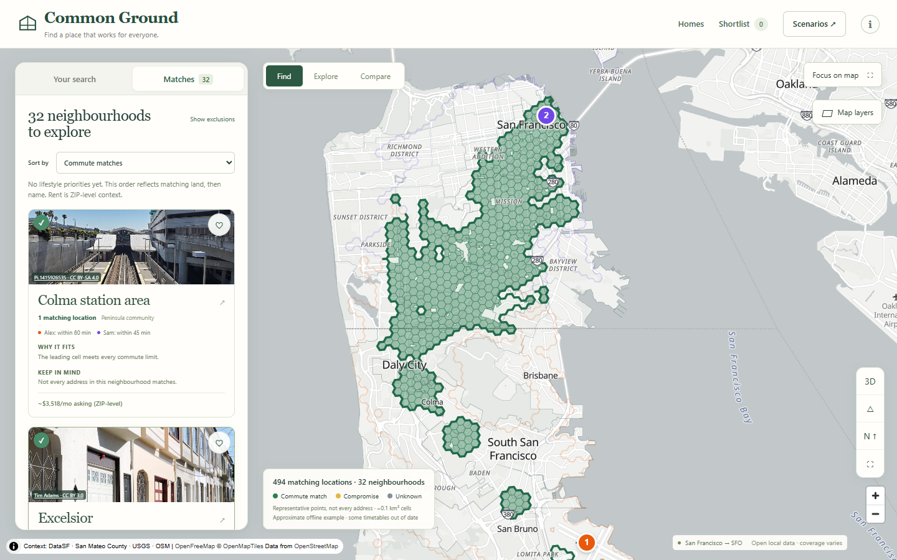
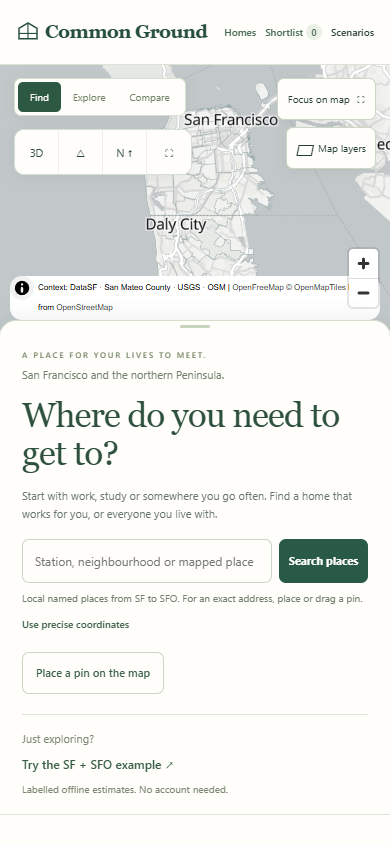

# Review screenshots

Captured from the local production build in installed Chrome on 12 November 2026,
using reduced motion, the public SF/SFO example and actual OpenFreeMap tiles.
There are no private household locations in these captures. The screenshot probe
reported zero page errors and no horizontal overflow at all three sizes.

| Viewport | Opening | Matches | Neighbourhood detail |
|---|---|---|---|
| 1440 × 900 | [Desktop opening](review/desktop-opening.png) | [Desktop matches](review/desktop-matches.png) | [Desktop detail](review/desktop-detail.png) |
| 1024 × 768 | [Tablet opening](review/tablet-opening.png) | [Tablet matches](review/tablet-matches.png) | [Tablet detail](review/tablet-detail.png) |
| 390 × 844 | [Mobile opening](review/mobile-opening.png) | [Mobile matches](review/mobile-matches.png) | [Mobile detail](review/mobile-detail.png) |





Additional journeys:

- [Explore: actual buildings and USGS terrain](review/desktop-explore.png). Neutral OSM-derived building dimensions, 52° camera pitch and actual-scale terrain. Heights may be inferred from storeys; they are not match scores or surveyed building measurements.
- [Named scenarios and portable sharing](review/desktop-scenarios.png).
- [Prospective homes on desktop](review/desktop-homes.png) and [mobile](review/mobile-homes.png). These use an illustrative manually entered home/rent in the browser test, not scraped listings or a measured property valuation.
- [Capture diagnostics](review/screenshots.json) and [local HTTP evidence](review/http-headers.json).

Reproduce after a fixture-mode production build and local preview:

```powershell
$env:CG_BASE_URL='http://localhost:4173'
node scripts/capture_upgrade.mjs
```

The mobile gesture regression uses actual Chrome touch events, not a desktop
mouse presented as a touch check. The map canvas supports keyboard pan/zoom and
Enter to place a pin; named result and detail buttons provide an accessible
alternative to selecting a canvas feature. Modal focus, Escape and restoration
are covered by browser tests.

The baseline was also exercised and captured before implementation. Its example
had the same 494 matching cells and 32 neighbourhoods. Original local Stadia tiles
did not load; that baseline was not counted as successful basemap verification.
